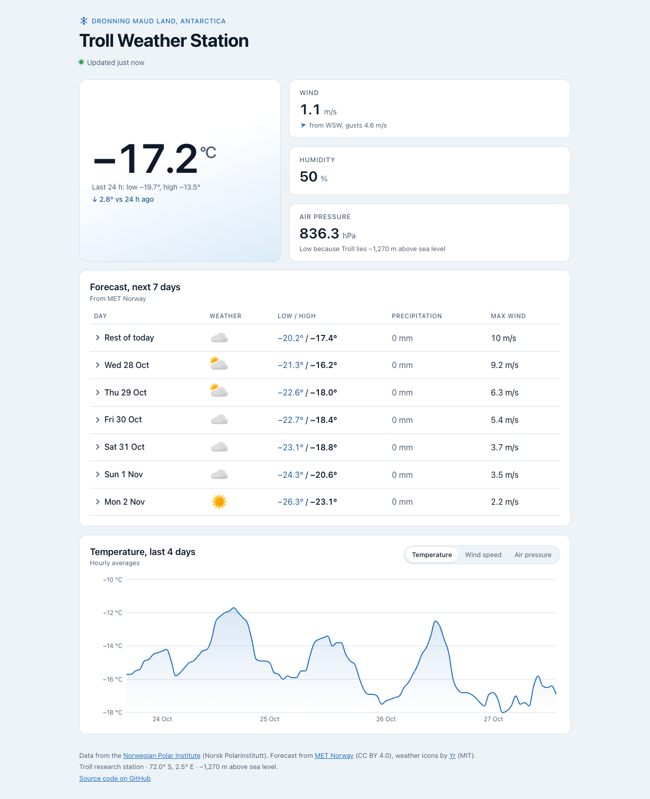
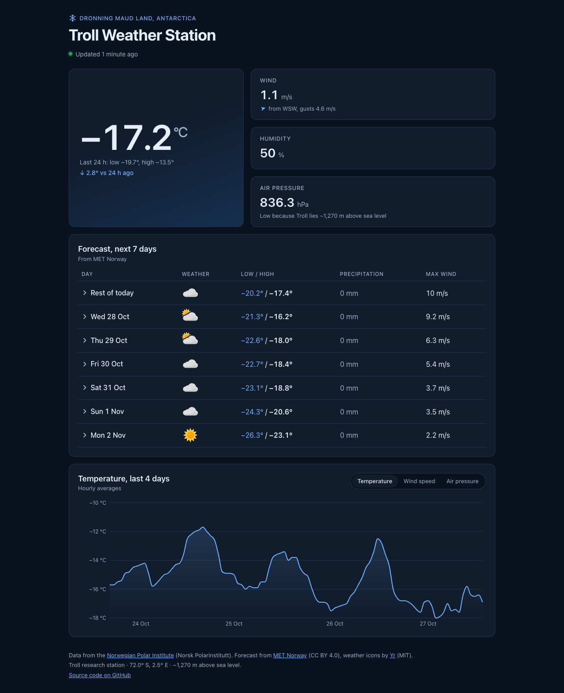
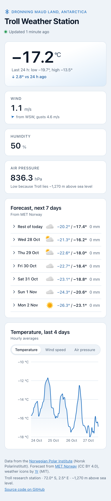

# Troll Weather Station

Live weather dashboard for the Norwegian **Troll research station** in Dronning Maud Land,
Antarctica, built with React. Live measurements come from the Norwegian Polar Institute and
the 7-day forecast from MET Norway (the same forecast as Yr).

**[Live demo →](https://trulstp.github.io/troll-weather/)**



<p>
  
  
</p>

## Features

- **Current conditions** — temperature with 24-hour low/high and trend, wind chill
  ("feels like") when it applies, wind speed with direction and gusts, humidity and air pressure
- **7-day forecast** — weather symbol, low/high, precipitation and max wind per day;
  expand a day to see it in 6-hour periods, like Yr
- **4-day chart** of hourly averages, switchable between temperature, wind and pressure
- **Live** — refreshes every 5 minutes while the tab is visible, shows "Updated 3 minutes ago" and flags stale data
- **Light and dark mode** following the system setting
- **Responsive** layout from phone to desktop

## Engineering highlights

### ~400× smaller data payload

The first version downloaded every per-minute reading for the last four days
(~7000 documents, **~4.7 MB, ~2.2 s**) and then threw most of them away to draw the chart.
It now lets OpenSearch do the work: one query returns the latest reading, hourly averages
(`date_histogram`) and the 24-hour min/max (`filter` aggregation) — **~15 KB in ~0.2 s**.
See [`src/api.js`](src/api.js).

### Stale-while-revalidate caching

Responses are cached in `localStorage`. Repeat visits render instantly from the cache and
refresh in the background once the data is more than 5 minutes old. If a refresh fails, the
last readings stay on screen with a notice instead of an error page. Storage errors (private
mode, full quota, corrupted entries) are handled and covered by tests.
See [`src/useCachedData.js`](src/useCachedData.js).

### Two data sources, each cached by its own rules

The station measurements and the MET Norway forecast are fetched independently with the same
caching hook, so a forecast outage never hides the live readings (or the other way round).
MET Norway's terms require clients to respect the `Expires` header; the forecast is a plain
`GET`, so the browser's HTTP cache enforces that on top of the 30-minute app-level cache.
The expanded 6-hour periods reuse the same de-duplicated precipitation, so they always add up
to the day total.

### Forecast aggregation in station time

MET's forecast is hourly for the first ~2.5 days and 6-hourly after that, with overlapping
1-hour and 6-hour precipitation blocks. [`src/forecast.js`](src/forecast.js) picks the right
block from the step to the next entry (so nothing is counted twice), groups by calendar day
in the station's own time zone (`Antarctica/Troll`, which switches between UTC+0 and UTC+2),
and chooses the midday symbol for each day, like Yr. All of this is unit tested.

### Accessibility

- Semantic structure: landmarks, a logical heading outline, `dl`/`dt`/`dd` for measurements
- Units spelled out for screen readers ("−20.4 degrees Celsius", not "°C")
- Missing sensor readings shown as "–" and announced as "Not available"
- Forecast is a real data table with row and column headers; icons have text alternatives
- Expandable days use a `button` with `aria-expanded`/`aria-controls`; the whole row is clickable
- Chart has a text alternative with its range; metric switcher uses `aria-pressed`
- Visible focus styles, minimal motion (respects `prefers-reduced-motion`), colour contrast
  checked in both themes

### Page load and sustainability review

Measured on the production build (Lighthouse 12, simulated mobile 4G, median of 3 runs;
transfer sizes from Chrome DevTools Protocol; CO₂e from
[co2.js](https://developers.thegreenwebfoundation.org/co2js/overview/) using the Sustainable
Web Design model v4).

| | Before | After |
|---|---:|---:|
| Lighthouse Performance | 90 | **99** |
| First Contentful Paint | 1.7 s | **1.2 s** |
| Largest Contentful Paint ¹ | 1.9 s | **1.9 s** |
| Time to Interactive | 2.3 s | **1.9 s** |
| Total Blocking Time | 59 ms | **0 ms** |
| JavaScript start-up | 372 ms | **97 ms** |
| Cumulative Layout Shift (phone) | 0.18 | **0** |
| First visit on a phone | 188 KB · 28.6 mg CO₂e | **94 KB · 14.3 mg CO₂e** |
| Repeat visit (fresh cache) | 0.8 KB | 0.8 KB |
| Tab left open in background, 8 h | 1.9 MB · 283 mg CO₂e | **0 KB** |

¹ *Before*, the LCP element was the footer text shown while data loaded, so 1.9 s measured the
loading screen. *After*, it is the temperature itself – the same time, but now for real content.

What changed and why:

- **Chart code is split out and loaded on demand.** Recharts was 84 % of the JavaScript, yet
  the chart sits below the fold. It now loads as a separate chunk only when the visitor
  scrolls near it (`React.lazy` + `IntersectionObserver`), halving the first-visit download
  on phones (initial JS 163 → 66 KB gzip).
- **Data starts downloading with the HTML, not after the JavaScript.** A tiny inline script
  adds `<link rel="preload">` for both APIs — but only when the cached copy is stale, so
  repeat visits download nothing extra. See [`vite.config.js`](vite.config.js).
- **No CORS preflight.** The OpenSearch query is sent as a `GET` with the query in the URL
  instead of a JSON `POST`, which saves the extra `OPTIONS` round trip.
- **No polling in background tabs.** Refreshes pause when the tab is hidden
  (Page Visibility API) and catch up when it becomes visible again.
- **No layout shift.** The footer used to jump off-screen when content arrived, and the chart
  now has a placeholder with its exact height.
- **Already efficient:** system fonts (no web-font downloads), SVG icons loaded only when shown,
  server-side aggregation (~400× smaller data), dark mode for OLED screens, minimal animation.

Hosting: GitHub Pages (Fastly) is verified green by the
[Green Web Foundation](https://www.thegreenwebfoundation.org/). The two data APIs are not in
its directory, so their energy source is unverified. GitHub Pages also caches hashed assets
for only 10 minutes; a host that allows `Cache-Control: immutable` (e.g. Netlify or Cloudflare
Pages) would avoid revalidation requests on later visits.

## Getting started

Requires Node.js 20.19+ or 22.12+.

```bash
git clone https://github.com/trulstp/troll-weather.git
cd troll-weather
npm install
npm run dev
```

Open http://localhost:5173.

| Command | Description |
|---|---|
| `npm run dev` | Start the dev server |
| `npm test` | Run the unit tests (Vitest) |
| `npm run lint` | Lint with ESLint |
| `npm run build` | Production build to `dist/` |
| `npm run preview` | Serve the production build locally |

Every push runs lint, tests and build in GitHub Actions; pushes to `main` are deployed
to GitHub Pages.

## Project structure

```
src/
├── api.js                 OpenSearch query and response parsing (measurements)
├── forecast.js            MET Norway forecast fetch and per-day aggregation
├── sources.js             API URLs, cache keys and max ages (also used by vite.config.js)
├── useCachedData.js       Data hook with localStorage cache and visibility-aware refresh
├── symbols.js             Weather symbol descriptions (from metno/weathericons)
├── weather.js             Wind chill, compass direction, temperature trend
├── format.js              Station time zone, dates, relative time, numbers
├── useNow.js              Ticking clock for "updated X minutes ago"
├── components/
│   ├── CurrentConditions  Hero temperature and secondary measurements
│   ├── Forecast           7-day forecast table with expandable 6-hour periods
│   ├── WhenVisible        Renders children only when scrolled near (lazy chart)
│   └── WeatherChart       4-day chart with metric switcher (separate chunk)
└── *.test.js              Unit tests
```

## Tech

React 19 · Vite 8 · Recharts · Vitest · ESLint · GitHub Actions / Pages

**Recharts** was chosen for the chart because it is built for React, has a
declarative API and good documentation.

## Notes

- The station has no precipitation gauge — precipitation comes from the forecast only.
  In this polar desert it is usually 0 mm, falling as light snow when it does occur.
- Times and dates are shown in station time (`Antarctica/Troll`).
- The chart shows hourly averages; the cards show the latest per-minute reading.
- Wind chill uses the North American / UK formula and is only shown for wind above 4.8 km/h.
- The low air pressure (~840 hPa) is expected: Troll lies about 1,270 m above sea level.

Data: [Norwegian Polar Institute](https://www.npolar.no/en/) open weather API ·
forecast from [MET Norway](https://api.met.no/) (CC BY 4.0) ·
weather icons from [metno/weathericons](https://github.com/metno/weathericons) (MIT).
